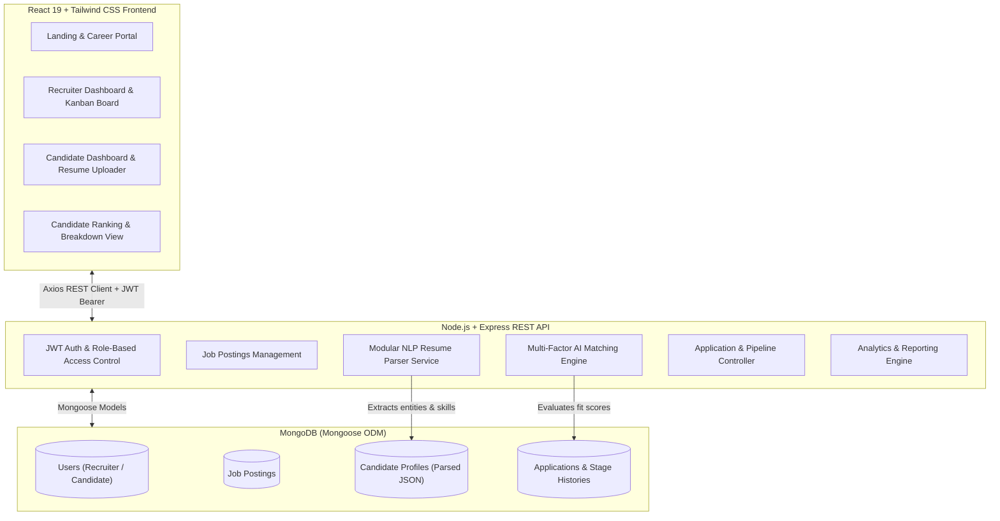

# AI Recruit Pro 🚀
### Intelligent Full-Stack AI-Assisted Recruitment System

**AI Recruit Pro** is an enterprise-grade, full-stack recruitment automation platform engineered to streamline talent acquisition. It features **modular NLP resume ingestion**, **multi-factor weighted candidate-job matching**, and an **interactive 6-stage Kanban pipeline** with interview scheduling.

---

## 🏗️ System Architecture



---

## ⚡ Tech Stack

| Layer | Technology | Description |
|---|---|---|
| **Frontend** | React.js (Vite), React Router v7, Axios, Tailwind CSS v4, Lucide Icons | Modern, reactive dark-mode user interface with responsive layouts and feedback animations |
| **Backend** | Node.js, Express.js (REST API) | Modular, clean architecture with separation of controllers, services, and middlewares |
| **Database** | MongoDB + Mongoose ODM | Document-based data store with indexing, relationships, and validation |
| **Authentication** | JWT (JSON Web Tokens) + BcryptJS | Secure token authorization with two roles: **Recruiter** and **Candidate** |
| **AI / NLP Engine** | `compromise`, `natural` (TF-IDF), `pdf-parse`, `mammoth` | Modular extraction of contact details, 500+ tech taxonomy skills, experience duration, and education level |
| **Matching Algorithm** | Weighted Multi-Factor Scoring | 50% Skills Overlap + 25% Experience Fit + 15% Education Fit + 10% Semantic Text Relevance |

---

## 🌟 Core Modules

### 1. 🔐 Authentication & User Management
- Recruiter and Candidate self-serve registration & login.
- JWT-based authorization middleware protecting recruiter-only endpoints (`createJob`, `updateStage`, `scheduleInterview`, `getRankedCandidates`) and candidate endpoints.
- Quick 1-click demo account switcher built directly into login and navigation.

### 2. 📋 Job Posting Management
- Complete CRUD operations for job listings (Title, Department, Location, Employment Type, Min/Max Experience, Education Requirement, Salary range, Description).
- Tag-based required skills and optional skills management.
- Live applicant count tracking.

### 3. 📄 Modular AI Resume Parser Service (`resumeParser.js`)
- Ingests **PDF**, **DOCX**, and **TXT** files or raw text.
- Extracts:
  - **Candidate Contact**: Name, Email, Phone, Location, Portfolio / Social Links (GitHub, LinkedIn).
  - **Skills Taxonomy**: 500+ curated technical and soft skills across Web, Mobile, Cloud, DevOps, AI/ML, Data, and System Design.
  - **Work Experience**: Extracted positions, companies, bullet points, and accurately calculated total years of experience.
  - **Education**: Degree classification (PhD, Master's, Bachelor's, Associate, High School) and institutions.
  - **Confidence Score & Metadata**: Processing time and parser confidence.
- Clean contract: `(fileBuffer, mimeType, originalName) -> Promise<ExtractedProfileJSON>`, making it effortless to plug in OpenAI/Gemini/Anthropic LLMs in the future!

### 4. 🎯 Candidate–Job Matching & Ranking Engine (`matchingEngine.js`)
- Computes an **Overall Compatibility Score (0 - 100%)** via weighted formula:
  $$\text{Score} = (0.50 \times \text{Skills}) + (0.25 \times \text{Experience}) + (0.15 \times \text{Education}) + (0.10 \times \text{Semantic NLP Fit})$$
- Returns ranked candidates sorted descending by score with an itemized breakdown:
  - Matched skills & Missing required skills.
  - Experience status (`Meets`, `Exceeds`, `Below`).
  - Education level fit.
  - AI Recommendation Tier: **Strong Match (80%+)**, **Good Match (65–79%)**, **Potential Match (50–64%)**, or **Low Match (<50%)**.

### 5. 📊 6-Stage Shortlisting & Kanban Pipeline
- Recruiters can advance candidates through:
  $$\text{Applied} \longrightarrow \text{Screened} \longrightarrow \text{Shortlisted} \longrightarrow \text{Interview Scheduled} \longrightarrow \text{Selected} \lor \text{Rejected}$$
- Full transition history with timestamps and audit notes.
- Integrated **Interview Scheduler** with Google Meet / Zoom meeting links, interviewer assignment, round type, and preparation notes.

### 6. 📈 Role-Specific Dashboards
- **Recruiter Dashboard**: Live statistics (Active Jobs, Total Applicants, Shortlisted, Interviews, Avg Match Fit), recent applicant activity stream, and fast job management.
- **Candidate Dashboard**: AI Profile summary, visual application tracker with stage progress bars, upcoming interview alerts with direct video call links, and recommended open roles with compatibility scores.

---

## 👥 Demo User Accounts

The database comes pre-seeded with realistic accounts and pre-evaluated applicant data:

| Role | Email | Password | Details |
|---|---|---|---|
| **Recruiter** | `recruiter@airecruit.pro` | `password123` | Sarah Jenkins (Head of Talent @ CloudScale Technologies) |
| **Recruiter** | `recruiter2@airecruit.pro` | `password123` | Marcus Chen (Tech Recruiter @ Apex AI Labs) |
| **Candidate** | `alex.dev@example.com` | `password123` | Alex Rivera (Senior Full Stack, 6 yrs exp, Master's) |
| **Candidate** | `sarah.data@example.com` | `password123` | Dr. Sarah Lin (AI/ML Engineer, 5 yrs exp, PhD Stanford) |
| **Candidate** | `david.cloud@example.com` | `password123` | David Miller (DevOps & Cloud Architect, 7 yrs exp) |
| **Candidate** | `priya.fullstack@example.com` | `password123` | Priya Sharma (Frontend React Specialist, 4 yrs exp) |
| **Candidate** | `emily.junior@example.com` | `password123` | Emily Watson (Junior Web Developer, 1.5 yrs exp) |

---

## 🚀 Getting Started Locally

### Prerequisites
- **Node.js** v18+ or v20+ or v24+
- **MongoDB** running locally (`mongodb://127.0.0.1:27017`) or a MongoDB Atlas URI

### 1. Clone & Install Dependencies
From the repository root:
```bash
# Install root dependencies
npm install

# Install server dependencies
npm --prefix server install

# Install client dependencies
npm --prefix client install
```

### 2. Configure Environment Variables
Copy `.env.example` to `server/.env`:
```bash
# Server configuration (server/.env)
PORT=5000
NODE_ENV=development
MONGODB_URI=mongodb://127.0.0.1:27017/ai-recruit-pro
JWT_SECRET=super_secret_jwt_key_ai_recruit_pro_2026_secure
JWT_EXPIRES_IN=7d
UPLOAD_DIR=uploads
MAX_FILE_SIZE_MB=10
```

### 3. Seed Sample Database
Populate recruiters, candidates, jobs, resumes, and Kanban pipeline applications:
```bash
npm run seed
```

### 4. Run Automated Backend Tests
Run the 12/12 integration test suite:
```bash
npm run test
```

### 5. Start Development Servers
Run both backend API (`localhost:5000`) and React frontend (`localhost:3000`) concurrently:
```bash
npm run dev
```

Or run them in separate terminals:
```bash
# Terminal 1: Backend API
npm run server

# Terminal 2: Frontend App
npm run client
```

Open your browser at **`http://localhost:3000`**.

---

## 📡 REST API Endpoint Documentation

### Authentication (`/api/auth`)
- `POST /api/auth/register` — Register a recruiter or candidate.
- `POST /api/auth/login` — Login and receive JWT Bearer token.
- `GET /api/auth/me` — Get current logged-in user profile.
- `PUT /api/auth/profile` — Update user details.

### Job Postings (`/api/jobs`)
- `GET /api/jobs` — Retrieve active jobs with keyword, type, location, and exp filters.
- `GET /api/jobs/my-jobs` — (Recruiter) Get all jobs posted by the logged-in recruiter.
- `GET /api/jobs/:id` — Get single job details with applicant counts.
- `POST /api/jobs` — (Recruiter) Create a new job posting.
- `PUT /api/jobs/:id` — (Recruiter) Update job posting.
- `DELETE /api/jobs/:id` — (Recruiter) Delete job posting and associated applications.

### Resume & NLP Parser (`/api/resume`)
- `POST /api/resume/upload` — Upload PDF/DOCX file or raw text to parse and generate `CandidateProfile`.
- `GET /api/resume/my-profile` — (Candidate) Get candidate's parsed resume profile.
- `PUT /api/resume/my-profile` — (Candidate) Update extracted profile fields and skills.
- `GET /api/resume/:id` — (Recruiter) Get candidate's parsed profile by ID.

### Matching & Ranking (`/api/matching`)
- `GET /api/matching/job/:jobId/ranked-candidates` — (Recruiter) Get ranked candidates for a job sorted by match score.
- `GET /api/matching/evaluate/:jobId` — Evaluate candidate fit against a specific job.

### Applications & Pipeline (`/api/applications`)
- `POST /api/applications/apply/:jobId` — (Candidate) Submit 1-click application with instant AI evaluation.
- `GET /api/applications/job/:jobId` — (Recruiter) Get all applicants for a job (Kanban data).
- `PUT /api/applications/:id/stage` — (Recruiter) Move application stage with audit history.
- `PUT /api/applications/:id/schedule-interview` — (Recruiter) Schedule or update interview details.
- `PUT /api/applications/:id/notes` — (Recruiter) Add recruiter feedback notes.
- `GET /api/applications/my-applications` — (Candidate) Get candidate's submitted applications.

### Analytics & Stats (`/api/stats`)
- `GET /api/stats/recruiter` — Recruiter dashboard metrics and stage distribution.
- `GET /api/stats/candidate` — Candidate dashboard metrics and tracker summary.

---

## 🔮 Future Enhancements & LLM API Swapping
The `resumeParser.js` service is completely decoupled. To swap the compromise/natural NLP parser for an LLM (e.g. OpenAI GPT-4o, Google Gemini, or Claude 3.5), simply replace the `parseResume` function with an LLM structured JSON completion call matching the same `(fileBufferOrText) -> { parsedData, rawText, parsingMetadata }` contract!

---

## 📄 License
ISC License — Built for AI-Assisted Recruitment & Talent Intelligence.
